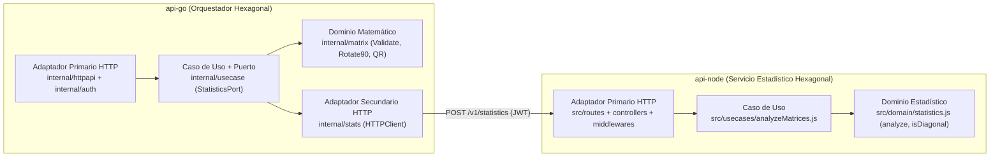

# Procesamiento de matrices

Dos APIs y un cliente, separados a propósito. Go recibe una matriz rectangular, la rota, calcula su factorización QR y le pide a Node las estadísticas de la matriz rotada. El frontend no vive dentro de ninguna de las dos APIs.

No es una plataforma de microservicios. La justificación está en [docs/decisiones.md](docs/decisiones.md).

## Qué hace cada parte

| Pieza | Rol |
| --- | --- |
| `api-go` | Fiber v2 (Arquitectura Hexagonal). Rota 90° en sentido horario, factoriza QR con gonum y orquesta la llamada a Node por HTTP. |
| `api-node` | Express (Arquitectura Hexagonal). Máximo, mínimo, promedio, suma y verificación de si alguna matriz es diagonal. |
| `web` | Cliente Vite + React. Consulta las dos APIs. |

Ejemplo: `[[1, 2, 3], [4, 5, 6]]` se rota a `[[4, 1], [5, 2], [6, 3]]` (`90_clockwise`). La suma global incluye Q y R y por eso no es 21, y `hasDiagonalMatrix` es false; en `[[2, 0, 0], [0, -5, 0], [0, 0, 9]]` es true (la rotada no es diagonal; Q y R sí).

## Probar ya

El sistema ya está en Render. Las URLs no llevan barra final.

El frontend (https://matrix-web-albq.onrender.com, `demo` / `demo123`) es la prueba visual del mismo flujo: login, pegar la matriz, ver rotación y estadísticas.

- Go: https://matrix-api-go-67me.onrender.com
- Node: https://matrix-api-node-39jd.onrender.com

Usuario `demo`, contraseña `demo123`. El token dura 1 hora y el mismo JWT vale en las dos APIs.

## Flujo de punta a punta

En la misma sesión de PowerShell. El plan gratuito duerme los servicios: si el primer intento tarda, o el paso 2 responde `502`, espera y reintenta `GET /health` en los dos hasta que `status` sea `ok`.

```powershell
Invoke-RestMethod -Method Get -Uri https://matrix-api-go-67me.onrender.com/health
Invoke-RestMethod -Method Get -Uri https://matrix-api-node-39jd.onrender.com/health
```

### 1. Login

`POST /v1/auth/login`. Guarda `token`.

```powershell
$login = Invoke-RestMethod -Method Post -Uri https://matrix-api-go-67me.onrender.com/v1/auth/login -ContentType "application/json" -Body '{"username":"demo","password":"demo123"}'
$token = $login.token
```

### 2. Procesar la matriz

`POST /v1/matrices/process` con `Authorization: Bearer`. Go rota, calcula el QR de la original y llama a Node. La respuesta trae `rotated`, `qr` y `statistics`: con eso quedan probadas las dos APIs.

```powershell
$headers = @{ Authorization = "Bearer $token" }
Invoke-RestMethod -Method Post -Uri https://matrix-api-go-67me.onrender.com/v1/matrices/process -Headers $headers -ContentType "application/json" -Body '{"matrix":[[1,2,3],[4,5,6]]}'
```

Comprueba `rotated` igual a `[[4,1],[5,2],[6,3]]`, `rotation` igual a `90_clockwise` y `statistics.hasDiagonalMatrix` en false. `statistics.sum` suma la rotada, Q y R, así que no es 21.

### 3. Estadísticas en Node (opcional)

El mismo token sirve para ver el segundo endpoint aislado. Una sola matriz.

`POST /v1/statistics`

```powershell
Invoke-RestMethod -Method Post -Uri https://matrix-api-node-39jd.onrender.com/v1/statistics -Headers $headers -ContentType "application/json" -Body '{"matrices":[{"name":"rotated","values":[[4,1],[5,2],[6,3]]}]}'
```

Ahí solo entra la rotada: `hasDiagonalMatrix` es false y `sum` es 21.

El detalle de cada path está en [docs/openapi.yaml](docs/openapi.yaml); se puede importar en un cliente HTTP.

## Arranque local

La prueba contra lo desplegado está en las secciones anteriores. Para correrlo en la máquina hace falta Go 1.27, Node 24 y una copia de `.env` con un secreto propio. `.env` está en `.gitignore`; el secreto nunca va en `.env.example` ni en el repositorio. Con un `JWT_SECRET` de menos de 32 caracteres ninguna de las dos arranca.

```powershell
Copy-Item .env.example .env
# Genera un secreto y reemplaza la línea JWT_SECRET de .env con él
node -e "console.log(require('crypto').randomBytes(48).toString('base64url'))"
```

Ninguna de las APIs lee `.env` por sí misma. En PowerShell se cargan sus variables en la sesión así:

```powershell
Get-Content .env | Where-Object { $_ -match '^\s*[^#].*=' } | ForEach-Object {
  $key, $value = $_ -split '=', 2
  Set-Item "env:$($key.Trim())" $value.Trim()
}
```

Con las variables cargadas:

```powershell
cd api-node
npm install
npm test
npm start

cd ..\api-go
go test ./...
go run ./cmd/server

cd ..\web
npm install
npm run dev
```

El frontend queda en `http://localhost:5173`. Go escucha en el puerto 8080 y Node en el 3000. El mismo flujo de arriba sirve en local: Go en `http://localhost:8080` y Node en `http://localhost:3000`.

## Docker

```powershell
docker compose up --build
```

- Frontend: http://localhost:5173
- API Go: http://localhost:8080
- API Node: http://localhost:3000

Dentro de Compose, Go llama a Node por `http://api-node:3000`. El navegador sigue usando las URLs publicadas en el host.

## Prueba de integración

Con las dos APIs locales ya levantadas:

```powershell
node tests/integration.mjs
```

Comprueba salud, login, rotación, QR y que el token de Go también lo acepta Node.

## Despliegue

Ya está en Render, en las URLs de arriba, sin barra final.

Para repetir el blueprint: [docs/despliegue.md](docs/despliegue.md).

## Patrones de Arquitectura y Diseño Aplicados

El sistema aplica **Arquitectura Hexagonal (Ports & Adapters) / Clean Architecture** en ambos servicios junto con el patrón **Service Orchestration** e **Inyección de Dependencias (Composition Root)**:



- **Dominio puro (`api-go/internal/matrix`, `api-node/src/domain`)**: Reglas de negocio y álgebra lineal libres de dependencias HTTP, con cota de seguridad dimensional (`250x250`) y cálculo de error de reconstrucción QR con norma de Frobenius \(O(m \cdot n)\).
- **Aplicación y Puertos (`api-go/internal/usecase`, `api-node/src/usecases`)**: Orquestación desacoplada mediante el puerto de salida `StatisticsPort` y errores semánticos (`ValidationError` \(\rightarrow\) `400`, `UpstreamError` \(\rightarrow\) `502`).
- **Adaptadores Primarios y Secundarios (`httpapi`, `stats`, `auth`, `config` en Go; `routes`, `controllers`, `middlewares`, `services`, `config` en Node)**: Servidores HTTP con timeouts explícitos, cliente HTTP con propagación de `context.Context`, límite de intentos de login y autenticación JWT HS256 con comparación de credenciales en tiempo constante (`SHA-256` + `ConstantTimeCompare`/`timingSafeEqual`).

### Estructura de `api-node`

```
api-node/
  src/
    config/env.js                   lee y valida el entorno (falla al arrancar si es inválido)
    domain/                         errors.js, statistics.js (analyze, isDiagonal), sin Express
    usecases/analyzeMatrices.js     caso de uso con el analizador inyectable
    controllers/                    auth, statistics, health: traducen HTTP <-> caso de uso
    middlewares/                    JWT Bearer, rate limit del login, manejo de errores
    routes/                         index.js monta /health, /v1/auth y /v1/statistics
    services/token.service.js       firma/verifica JWT y compara credenciales
    app.js                          createApp(config, { analyzeUseCase })
    server.js                       composition root
  test/
    unit/                           dominio, caso de uso, token, config
    integration/app.test.js         HTTP de punta a punta sobre un puerto efímero
```

No hay `models`, `seeds` ni `uploads`: el servicio no persiste nada ni recibe archivos.
