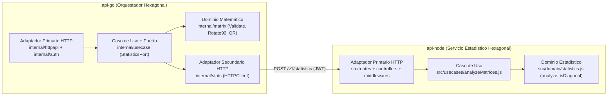

# Procesamiento de matrices

Dos APIs y un cliente, separados a propósito. Go recibe una matriz rectangular, la rota, calcula su factorización QR y le pide a Node las estadísticas de la matriz rotada. El frontend no vive dentro de ninguna de las dos APIs.

No es una plataforma de microservicios. La justificación está en [docs/decisiones.md](docs/decisiones.md). El contrato está en [docs/openapi.yaml](docs/openapi.yaml).

## Qué hace cada parte

| Pieza | Rol |
| --- | --- |
| `api-go` | Fiber v2 (Arquitectura Hexagonal). Rota 90° en sentido horario, factoriza QR con gonum y orquesta la llamada a Node por HTTP. |
| `api-node` | Express (Arquitectura Hexagonal). Máximo, mínimo, promedio, suma y verificación de si alguna matriz es diagonal. |
| `web` | Cliente Vite + React. Consulta las dos APIs. |

Ejemplo: `[[1, 2, 3], [4, 5, 6]]` se rota a `[[4, 1], [5, 2], [6, 3]]` (`90_clockwise`). La suma global incluye Q y R y por eso no es 21, y `hasDiagonalMatrix` es false; en `[[2, 0, 0], [0, -5, 0], [0, 0, 9]]` es true (la rotada no es diagonal; Q y R sí).

## Patrones de Arquitectura y Diseño Aplicados

El sistema aplica **Arquitectura Hexagonal (Ports & Adapters) / Clean Architecture** en ambos servicios junto con el patrón **Service Orchestration** e **Inyección de Dependencias (Composition Root)**:



- **Dominio puro (`api-go/internal/matrix`, `api-node/src/domain`)**: Reglas de negocio y álgebra lineal libres de dependencias HTTP, con cota de seguridad dimensional (`250x250`) y cálculo de error de reconstrucción QR con norma de Frobenius \(O(m \cdot n)\).
- **Aplicación y Puertos (`api-go/internal/usecase`, `api-node/src/usecases`)**: Orquestación desacoplada mediante el puerto de salida `StatisticsPort` y errores semánticos (`ValidationError` \(\rightarrow\) `400`, `UpstreamError` \(\rightarrow\) `502`).
- **Adaptadores Primarios y Secundarios (`httpapi`, `stats`, `auth`, `config` en Go; `routes`, `controllers`, `middlewares`, `services`, `config` en Node)**: Servidores HTTP con timeouts explícitos, cliente HTTP con propagación de `context.Context`, límite de intentos de login y autenticación JWT HS256 con comparación de credenciales en tiempo constante (`SHA-256` + `ConstantTimeCompare`/`timingSafeEqual`).

### Estructura de `api-node`

```
api-node/
  src/
    config/env.js                   lee y valida el entorno (falla al arrancar si es inválido)
    domain/                         errors.js, statistics.js (analyze, isDiagonal), sin Express
    usecases/analyzeMatrices.js     caso de uso con el analizador inyectable
    controllers/                    auth, statistics, health: traducen HTTP <-> caso de uso
    middlewares/                    JWT Bearer, rate limit del login, manejo de errores
    routes/                         index.js monta /health, /v1/auth y /v1/statistics
    services/token.service.js       firma/verifica JWT y compara credenciales
    app.js                          createApp(config, { analyzeUseCase })
    server.js                       composition root
  test/
    unit/                           dominio, caso de uso, token, config
    integration/app.test.js         HTTP de punta a punta sobre un puerto efímero
```

No hay `models`, `seeds` ni `uploads`: el servicio no persiste nada ni recibe archivos.

## Credenciales de revisión

| Campo | Valor |
| --- | --- |
| Usuario | `demo` |
| Contraseña | `demo123` |
| Vigencia del token | 1 hora |

El mismo JWT sirve en las dos APIs. `JWT_SECRET` debe tener al menos 32 caracteres; con uno más corto ninguna de las dos arranca.

## Arranque local

Hace falta Go 1.27, Node 24 y una copia de `.env` con un secreto propio. `.env` está en `.gitignore`; el secreto nunca va en `.env.example` ni en el repositorio.

```powershell
Copy-Item .env.example .env
# Genera un secreto y reemplaza la línea JWT_SECRET de .env con él
node -e "console.log(require('crypto').randomBytes(48).toString('base64url'))"
```

Ninguna de las APIs lee `.env` por sí misma. En PowerShell se cargan sus variables en la sesión así:

```powershell
Get-Content .env | Where-Object { $_ -match '^\s*[^#].*=' } | ForEach-Object {
  $key, $value = $_ -split '=', 2
  Set-Item "env:$($key.Trim())" $value.Trim()
}
```

Con las variables cargadas:

```powershell
cd api-node
npm install
npm test
npm start

cd ..\api-go
go test ./...
go run ./cmd/server

cd ..\web
npm install
npm run dev
```

El frontend queda en `http://localhost:5173`. Go escucha en el puerto 8080 y Node en el 3000.

## Docker

```powershell
docker compose up --build
```

- Frontend: http://localhost:5173
- API Go: http://localhost:8080
- API Node: http://localhost:3000

Dentro de Compose, Go llama a Node por `http://api-node:3000`. El navegador sigue usando las URLs publicadas en el host.

## Prueba de integración

Con las dos APIs ya levantadas:

```powershell
node tests/integration.mjs
```

Comprueba salud, login, rotación, QR y que el token de Go también lo acepta Node.

## Llamada directa

```powershell
$login = Invoke-RestMethod -Method Post -Uri http://localhost:8080/v1/auth/login -ContentType "application/json" -Body '{"username":"demo","password":"demo123"}'
$headers = @{ Authorization = "Bearer $($login.token)" }
Invoke-RestMethod -Method Post -Uri http://localhost:8080/v1/matrices/process -Headers $headers -ContentType "application/json" -Body '{"matrix":[[1,2,3],[4,5,6]]}'
```

## Despliegue

`render.yaml` crea tres web services Docker en el plan gratuito de Render: `matrix-api-node`, `matrix-api-go` y `matrix-web`.

1. Sube el repositorio a GitHub. `.env` está en `.gitignore` y no se sube; el secreto local no sale de tu máquina.
2. En Render: **New → Blueprint**, elige el repositorio y confirma `render.yaml`.
3. Render pide los valores marcados con `sync: false`:
   - `DEMO_PASSWORD` en `matrix-api-node`: `demo123`. Go lo toma de Node.
   - `CORS_ORIGIN` en las dos APIs: `*` por ahora.
   - `NODE_API_URL` en `matrix-api-go`, y `GO_API_URL` / `NODE_API_URL` en `matrix-web`: se pueden dejar vacías, todavía no se conocen las URLs.

   `JWT_SECRET` no se pide: Render lo genera en Node (256 bits en base64) y Go lo lee de ahí.
4. Cuando termine el primer despliegue, copia la URL pública de cada servicio (`https://<servicio>.onrender.com`) y en **Environment** completa:

   | Servicio | Variable | Valor |
   | --- | --- | --- |
   | `matrix-api-go` | `NODE_API_URL` | URL de `matrix-api-node` |
   | `matrix-web` | `GO_API_URL` | URL de `matrix-api-go` |
   | `matrix-web` | `NODE_API_URL` | URL de `matrix-api-node` |
   | las dos APIs | `CORS_ORIGIN` | URL de `matrix-web` |

   Las URLs no deben terminar en `/` (forma correcta: `https://<servicio>.onrender.com`). El frontend tolera una barra final, pero documéntalas sin ella.

   Guarda con redeploy. Go llama a Node por su URL pública: en el plan gratuito un web service no recibe tráfico de la red privada.

`TRUST_PROXY=true` está activo solo en Render, para que el límite de login use la IP de `X-Forwarded-For` y no la del proxy (ver [docs/decisiones.md](docs/decisiones.md)).

## Probar lo desplegado

El frontend es la prueba visual: https://matrix-web-albq.onrender.com (`demo` / `demo123`).

- Go: https://matrix-api-go-67me.onrender.com
- Node: https://matrix-api-node-39jd.onrender.com

```powershell
$login = Invoke-RestMethod -Method Post -Uri https://matrix-api-go-67me.onrender.com/v1/auth/login -ContentType "application/json" -Body '{"username":"demo","password":"demo123"}'
$headers = @{ Authorization = "Bearer $($login.token)" }
Invoke-RestMethod -Method Post -Uri https://matrix-api-go-67me.onrender.com/v1/matrices/process -Headers $headers -ContentType "application/json" -Body '{"matrix":[[1,2,3],[4,5,6]]}'
```

El plan gratuito duerme los servicios; el primer `GET /health` puede tardar cerca de un minuto. Si `process` responde `502`, espera y reintenta `GET /health` de Go y de Node.

`NODE_API_URL` y `CORS_ORIGIN` van sin barra final: si `NODE_API_URL` está vacía o termina en `/`, `process` responde `502`; `CORS_ORIGIN` debe ser `https://matrix-web-albq.onrender.com`. Si CORS está mal, el navegador falla y la llamada directa sigue funcionando.

Para la entrega: enlace del repositorio, https://matrix-web-albq.onrender.com y las credenciales `demo` / `demo123`.

## Endpoints

- `GET /health` en las dos APIs, sin token.
- `POST /v1/auth/login` con `{ "username", "password" }`. Máximo 10 intentos cada 15 minutos por IP en cada API; el siguiente responde `429` con `{ "error": "demasiados intentos de ingreso, intenta más tarde" }`.
- `POST /v1/matrices/process` en Go, con `{ "matrix": [[...]] }`.
- `POST /v1/statistics` en Node, con `{ "matrices": [{ "name": "rotated", "values": [[...]] }] }`.

Una matriz vacía, irregular o con valores no finitos responde `400`. Sin token, `401`. Demasiados intentos de login, `429`. Si Node no responde, Go responde `502` y no inventa las estadísticas.
