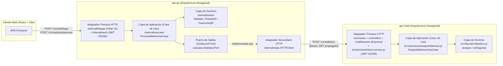

# Decisiones

El enunciado pide tomar decisiones y poder defenderlas. Estas son las que sostienen el código.

## No es una plataforma de microservicios

Hay dos APIs HTTP y un cliente. No hay base de datos, cola, service discovery ni API gateway. Separarlas es un requisito del reto: cada una tiene su lenguaje, su framework, su proceso y su contenedor.

- `api-go` orquesta el caso de uso.
- `api-node` solo calcula estadísticas.
- `web` no forma parte de ninguna API. Las consume.

## Rotación y factorización QR

El enunciado se contradice. La arquitectura, la frase siguiente y el frontend hablan de rotar la matriz. Una viñeta de la funcionalidad requerida dice que Go devuelve la factorización QR.

Se implementan las dos:

- La rotación es la transformación de 90° en sentido horario. Una matriz m×n pasa a ser n×m.
- La factorización QR es de la matriz original, no de la rotada. Se usa la forma reducida de LAPACK, vía gonum: Q es m×k con columnas ortonormales y R es k×n trapezoidal superior, con k = min(m, n). Así funciona tanto para matrices altas como anchas. El ejemplo `[[1,2,3],[4,5,6]]` es ancha, y `mat.QR` de gonum rechaza ese caso.

## Qué recibe Node

Las diapositivas 2 y 3 piden en plural que Node *"reciba el resultado de las matrices devueltas por la primera API"* y verifique *"si alguna matriz es diagonal"*, mientras que la diapositiva 1 menciona enviar la matriz rotada.

Para cubrir ambos criterios sin ambigüedad, Go envía a Node las tres matrices resultantes: `rotated`, `q` y `r`.

Las estadísticas (`max`, `min`, `average`, `sum`) son globales sobre todos los valores recibidos, y la respuesta incluye además el desglose `matrices` con las dimensiones e indicador `isDiagonal` de cada una (`rotated`, `q`, `r`). `hasDiagonalMatrix` es verdadero si alguna de las matrices evaluadas es cuadrada y sus elementos fuera de la diagonal principal son cero (con tolerancia `1e-9` para absorber residuos de punto flotante de LAPACK).

Así, cuando la entrada es una matriz diagonal como `[[2,0,0],[0,-5,0],[0,0,9]]`:
- `rotated` queda con los valores en la antidiagonal (`isDiagonal: false`).
- `q` (identidad) y `r` conservan estructura diagonal (`isDiagonal: true`).
- `hasDiagonalMatrix` devuelve `true` y el desglose muestra exactamente qué matriz fue diagonal y cuál no.

## Patrones de Arquitectura y Diseño Aplicados

Ambas APIs siguen explícitamente **Arquitectura Hexagonal (Ports & Adapters) / Clean Architecture**, aislando las reglas matemáticas de dominio de los frameworks HTTP y del transporte de red.

1. **Arquitectura Hexagonal (Ports & Adapters) / Clean Architecture**:
   - **Capa de Dominio (`internal/matrix` en Go, `src/domain` en Node)**: Funciones puras y entidades matemáticas sin acoplamiento a HTTP, JSON ni variables de entorno. Incluye validación dimensional (`MaxDimension = 250` contra ataques DoS), rotación 90° en sentido horario, factorización QR reducida mediante LAPACK (`DGEQRF` + `DORGQR`) con norma de Frobenius \(O(m \cdot n)\), y análisis estadístico en una sola pasada con detección de diagonal tolerante a punto flotante (`1e-9`).
   - **Capa de Aplicación / Casos de Uso (`internal/usecase` en Go, `src/usecases` en Node)**: `ProcessMatrixUseCase` coordina el flujo de negocio y define el puerto de salida `StatisticsPort` y el error tipado `UpstreamError`. En Node, `createAnalyzeMatricesUseCase` encapsula la ejecución del caso de uso.
   - **Adaptadores Primarios / Driving (`internal/httpapi` + `internal/auth` en Go, `src/routes` + `src/controllers` + `src/middlewares` + `src/services` en Node)**: Gestionan el protocolo HTTP, timeouts de servidor, cabeceras de seguridad (`X-Content-Type-Options: nosniff`), límite de intentos de login, autenticación JWT HS256 y traducción de errores de dominio/aplicación a códigos de estado HTTP (`400`, `401`, `429`, `502`).
   - **Adaptador Secundario / Driven (`internal/stats` en Go)**: `HTTPClient` implementa el puerto `StatisticsPort` con `context.Context`, límite de lectura de respuesta (`1 MB`) y propagación del JWT.
2. **Patrón Service Orchestration (Orquestador de Caso de Uso)**:
   - `api-go` actúa como orquestador síncrono del flujo y delega el cálculo estadístico a `api-node`, evitando duplicar lógica estadística en Go.
3. **Inyección de Dependencias (Composition Root) y Configuración 12-Factor App**:
   - Los puntos de entrada (`cmd/server/main.go` y `src/server.js`) leen y validan la configuración desde variables de entorno (`internal/config` y `src/config/env.js`) e inyectan los adaptadores en los casos de uso y servidores HTTP, permitiendo probar cada capa en aislamiento con dobles de prueba (`stubs` / `httptest`).

## Estructura de carpetas en Express

`api-node` pasó de archivos planos a carpetas por rol, sin cambiar rutas ni respuestas:

- `domain/` y `usecases/` no importan Express. `analyze` lanza `ValidationError` del dominio, no un error HTTP; el `errorHandler` es quien lo traduce a `400`. Así el dominio se prueba sin levantar servidor, igual que `internal/matrix` en Go.
- `routes/`, `controllers/` y `middlewares/` son juntos el adaptador primario HTTP. Las rutas solo declaran método, ruta y middlewares; los controladores traducen la petición al caso de uso y la respuesta a JSON; los middlewares resuelven lo transversal (JWT, rate limit, errores).
- `services/token.service.js` agrupa JWT y la comparación de credenciales, que usan tanto el login como el middleware de autenticación.
- `config/env.js` valida el entorno una vez. `server.js` es el composition root y `createApp(config, { analyzeUseCase })` permite inyectar dobles en las pruebas.
- No hay `models`, `seeds` ni `uploads`: no hay persistencia ni subida de archivos. Crear esas carpetas vacías solo aparentaría una capa que no existe.

Las pruebas viven fuera de `src/` (`test/unit` y `test/integration`), así la imagen Docker, que copia solo `src`, no las incluye.

## Seguridad

JWT HS256 con el mismo secreto en las dos APIs. El login de Go emite un token que Node también acepta, porque ambos usan el claim `sub` y el algoritmo HS256. Go reenvía ese token cuando llama a Node. No hay base de usuarios: las credenciales de demostración salen del entorno y se comparan en tiempo constante aplicando `SHA-256` previo (`crypto/subtle` en Go y `crypto.timingSafeEqual` en Node) para no filtrar la longitud de las credenciales por canal lateral de tiempo.

### Longitud mínima del secreto

Con HS256 cualquiera que tenga un token puede intentar adivinar el secreto fuera de línea; un secreto corto o de diccionario cae rápido. Las dos APIs rechazan arrancar si `JWT_SECRET` tiene menos de 32 caracteres (`JWT_SECRET debe tener al menos 32 caracteres`). El secreto local se genera con `crypto.randomBytes(48)` en base64url (64 caracteres, 384 bits) y solo vive en `.env`, que no se versiona. `.env.example` lleva un marcador y el comando para generarlo.

### Límite de intentos de login

`POST /v1/auth/login` acepta 10 intentos cada 15 minutos por IP en cada API (`express-rate-limit` en Node, `middleware/limiter` de Fiber en Go). Al pasarse responde `429` con `{ "error": "demasiados intentos de ingreso, intenta más tarde" }`. Cuentan también los intentos fallidos, que son justamente los de fuerza bruta. Solo se limita el login: `/v1/statistics` y `/v1/matrices/process` ya exigen JWT y `/health` lo usan los healthchecks.

El contador está en memoria de cada proceso, así que con varias réplicas cada una limita por separado; para eso haría falta un almacén compartido (Redis).

### IP del cliente detrás de un proxy (`TRUST_PROXY`)

Detrás del proxy de Render todas las peticiones llegan desde la IP del proxy, y un límite por IP se vuelve global. Con `TRUST_PROXY=true` las dos APIs toman la IP de `X-Forwarded-For` asumiendo un solo proxy de confianza: Node con `app.set("trust proxy", 1)` y Go con un `KeyGenerator` del limiter que usa la última entrada de la cabecera. Es la que agrega el proxy; la primera la puede escribir el cliente, y el proxy de Render agrega a la cabecera en lugar de reemplazarla.

Es opcional y viene apagado. Sin un proxy delante, confiar en `X-Forwarded-For` permite que cualquiera invente una IP por petición y se salte el límite. Solo `render.yaml` lo activa; Docker Compose y `.env.example` lo dejan apagado.

Límite conocido: en Render el tráfico pasa también por Cloudflare, así que la última entrada puede ser una IP del borde de Cloudflare y no la del cliente. El límite queda por nodo de borde: ya no es global y no se puede evadir falseando la cabecera, pero tampoco es exactamente por cliente.

## Frameworks

Fiber v2 es la capa HTTP de Go. Express es la de Node. La rotación, el QR y las estadísticas están fuera del framework para poder probarlos sin levantar el servidor. Fiber v3 ya está publicado; esta entrega se queda en v2 porque es la API que las pruebas ejercitan y alcanza para rutas, JWT y JSON.

## Despliegue

Tres contenedores. En local los une Docker Compose. En la nube, un blueprint de Render con tres web services. No hace falta un clúster: el requisito es poder desplegar las aplicaciones en otro entorno, no operar una malla de servicios.

En el plan gratuito un web service puede enviar tráfico por la red privada pero no recibirlo, así que Go llama a Node por su URL pública. El blueprint no puede derivar esas URLs (Render no interpola variables y `RENDER_EXTERNAL_URL` existe solo en tiempo de ejecución), por eso las URLs públicas y `CORS_ORIGIN` se completan a mano tras el primer despliegue. `JWT_SECRET` lo genera Render en Node (`generateValue`, 256 bits en base64, 44 caracteres) y Go lo referencia, así el secreto no pasa por nadie.
